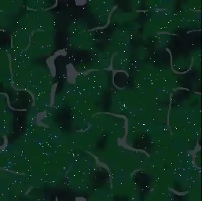
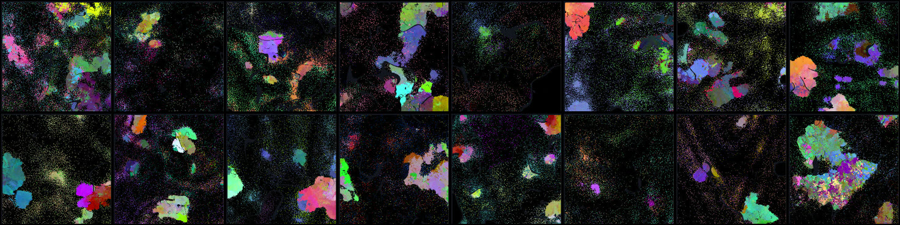
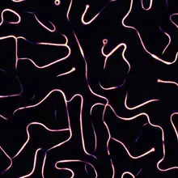
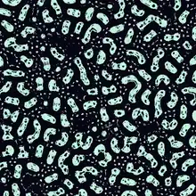
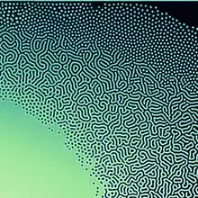

# auto

Artificial life and cellular automata on the GPU, in Rust and WebGPU.

Completely vibe coded. It's me continuing to experiment on my high school diploma project,
[Simulation of the evolutionary process](https://github.com/ErikFrankling/Simulation-of-the-evolutionary-process),
where neural networks evolve with NEAT. It's also inspired by Fraser Price's evolution sim
([thread](https://x.com/fraserpricee/status/2100357683060613259), [video](https://x.com/fraserpricee/status/2117284946863857939)).
This is a slightly different take on it.

<p align="center">
  
</p>

Every cell has its own small recurrent brain. There's no fitness function, only energy: cells that
gather enough of it split, and cells that run out die. Colour is the genome, so a patch of one colour
is one family.

<p align="center">
  
</p>

16 of the 384 worlds from the first screen. The results, with maps and videos, are
[here](https://erikfrankling.github.io/auto/life/screen.html). Next up is cells that can stick
together, to see if multicellular bodies show up on their own.

## Automata

<p align="center">
  
  
  
  
</p>

The same engine also runs regular cellular automata. Game of Life reaches about 5 trillion cell
updates a second on an RX 7900 XT. [Benchmarks and videos](https://erikfrankling.github.io/auto/),
or [run them in your browser](https://erikfrankling.github.io/auto/app/) (needs WebGPU).

## Run it

```sh
nix develop
./life                                                      # the artificial life app
cargo run --release -p auto-app --bin auto-view -- lenia    # the automata viewer
```
